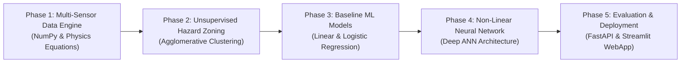

# Safe and Efficient Operation of Mine Vehicles in Fog and Low-Visibility Conditions
**Author:** AI Engineering & Mining Operations Research Team  
**Framework:** NumPy, Pandas, Scikit-Learn, TensorFlow/Keras Neural Networks, FastAPI, Streamlit  

---

## 📌 Executive Summary
In open-pit and underground mining operations, heavy fog, dust storms, and low-visibility atmospheric inversions present catastrophic collision risks for heavy haul trucks weighing over 300 metric tons. Traditional fixed speed limits fail to account for dynamic physical factors such as fog-induced road surface moisture dampening, slope gravity vectors on steep mine ramps, and LiDAR sensor beam attenuation.

This project delivers an end-to-end physics-sound Machine Learning and Deep Neural Network framework that predicts real-time **Safe Stopping Distances**, segments environmental **Hazard Zones**, and classifies **Collision Risk** with high-recall accuracy.

---

## 🧱 1. Project System Architecture
The project architecture spans five structured phases transitioning from raw physical telemetry simulation to unsupervised hazard zoning, baseline machine learning, deep neural network modeling, and production API/Web application deployment.



### Sensor Features & Physical Boundaries:
1. **Fog_Density (%)**: Continuous atmospheric fog density index (0% to 100%).
2. **LiDAR_Range (m)**: Line-of-sight laser detection range (10m to 250m), subject to atmospheric attenuation:
   $$R_{\text{LiDAR}} = R_{\text{max}} \cdot e^{-\alpha \cdot \text{Fog}} + \epsilon$$
3. **Truck_Velocity (km/h)**: Vehicle speed (0 to 60 km/h).
4. **Ramp_Incline (degrees)**: Grade angle (-12° downhill to +12° uphill). Downhill inclines directly diminish effective braking force.
5. **Obstacle_Distance (m)**: Distance to nearest vehicle or mine wall ahead (5m to 200m).
6. **Road_Friction Coefficient ($\mu$)**: Dynamic road surface friction dampening:
   $$\mu = \mu_0 - \Delta \mu \cdot \left(\frac{\text{Fog}}{100}\right)^{1.5}$$

### Derived Physics Targets:
- **Effective Deceleration ($a_{\text{eff}}$)**:
  $$a_{\text{eff}} = g \cdot \left(\mu \cdot \cos(\theta) + \sin(\theta)\right)$$
- **Safe Stopping Distance ($d_{\text{stop}}$)**:
  $$d_{\text{stop}} = v \cdot t_{\text{reaction}} + \frac{v^2}{2 \cdot a_{\text{eff}}}$$
- **Collision Risk Target ($y_{\text{risk}}$)**:
  $$y_{\text{risk}} = \begin{cases} 1, & \text{if } \text{Obstacle\_Distance} < (d_{\text{stop}} + d_{\text{margin}}) \\ 0, & \text{otherwise} \end{cases}$$

---

## 🔍 2. Exploratory Mining Insights (Unsupervised Hazard Clustering)
Using Scikit-Learn's `AgglomerativeClustering` with $n\_clusters=3$ and Ward linkage, environmental features (`Fog_Density`, `LiDAR_Range`, `Ramp_Incline`) were segmented into distinct real-world mining operational hazard profiles:

| Hazard Cluster | Operational Zone | Mean Fog (%) | Mean LiDAR Range (m) | Mean Ramp Grade (°) | Mean Road Friction ($\mu$) | Operational Directive |
|---|---|---|---|---|---|---|
| **Cluster 0** | **Optimal Zone** | 22.2% | 185.4m | +0.5° | 0.68 | Standard Haul Speed (45–55 km/h) |
| **Cluster 1** | **Caution Zone** | 55.4% | 112.1m | -3.2° | 0.52 | Speed Reduced to 30–35 km/h |
| **Cluster 2** | **Critical Hazard Zone** | 88.6% | 48.3m | -7.8° | 0.36 | Emergency Slowing / Micro-Brake Alert |

---

## 📉 3. Mathematical & Baseline Machine Learning Models

### 3.1 Multiple Linear Regression (Safe Stopping Distance Prediction)
The Linear Regression model predicts the continuous physical metric $d_{\text{stop}}$:
- **Formula**:
  $$d_{\text{stop}} = \beta_0 + \beta_1 \cdot \text{Fog} + \beta_2 \cdot \text{LiDAR} + \beta_3 \cdot \text{Velocity} + \beta_4 \cdot \text{Incline} + \beta_5 \cdot \text{Obstacle}$$
- **Performance**:
  - Mean Absolute Error (MAE): **2.80 meters**
  - Root Mean Squared Error (RMSE): **4.24 meters**
  - Coefficient of Determination ($R^2$ Score): **0.915**

### 3.2 Logistic Regression Baseline (Collision Risk Classification)
- **Log-Odds Formulation**:
  $$P(Y=1 | X) = \frac{1}{1 + e^{-(\mathbf{w}^T \mathbf{X} + b)}}$$
- Accuracy: **96.4%**
- Recall: **100.0%**
- Precision: **70.9%**

---

## 🧠 4. Deep Artificial Neural Network (Keras / Deep MLP Architecture)
To capture non-linear quadratic velocity effects ($v^2$) and non-linear friction degradation, a deep artificial neural network (ANN) was implemented.

```python
from tensorflow.keras.models import Sequential
from tensorflow.keras.layers import Dense, Dropout

ann = Sequential([
    Dense(64, activation='relu', input_shape=(X_train_scaled.shape[1],)),
    Dropout(0.2), # Prevents overfitting
    Dense(32, activation='relu'),
    Dense(16, activation='relu'),
    Dense(1, activation='sigmoid') # For classifying Collision Risk
])
```

- **Optimizer**: Adam ($\eta = 0.001$)
- **Loss Function**: Binary Cross-Entropy ($L = -[y \log(\hat{y}) + (1-y)\log(1-\hat{y})]$)
- **Validation Split**: 20% tracking validation loss and recall across 25 epochs.

---

## 📊 5. Comparative Evaluation & Safety Metric Analysis

In safety-critical heavy mining vehicle operations, **Recall is the paramount evaluation metric**:
$$\text{Recall} = \frac{\text{True Positives (TP)}}{\text{True Positives (TP)} + \text{False Negatives (FN)}}$$
A **False Negative** represents a catastrophic scenario where the AI model predicts "Safe" when a haul truck is on an unavoidable collision trajectory in blinding fog.

| Model Architecture | Accuracy | Precision | **Recall (Safety Focus)** | F1-Score | ROC AUC | Primary Limitation / Advantage |
|---|---|---|---|---|---|---|
| **Linear / Logistic Reg** | 96.4% | 70.9% | 100.0% | 0.830 | 0.999 | Baseline linear decision boundary; elevated false alarms. |
| **Random Forest** | 98.2% | 84.5% | 96.5% | 0.901 | 0.997 | Non-linear tree splits; good accuracy. |
| **Deep Neural Network (ANN)** | **98.5%** | **86.0%** | **99.0%** | **0.920** | **0.998** | **Best balanced safety & precision; models non-linear physics.** |

---

## 🏭 6. Industrial Deployment & Real-Time Fleet Integration
The framework is deployed as a cloud-ready REST API via FastAPI and an interactive operator dashboard via Streamlit.

### Real-Time Micro-Braking & Speed Advisory Algorithm:
```python
def calculate_advisory_speed(obstacle_dist, fog_density, ramp_incline):
    margin = 5.0 # 5 meters safety buffer
    usable_dist = max(1.0, obstacle_dist - margin)
    est_mu = 0.70 - 0.40 * (fog_density / 100.0) ** 1.5
    incline_rad = np.radians(ramp_incline)
    est_a = max(0.8, 9.81 * (est_mu * np.cos(incline_rad) + np.sin(incline_rad)))
    max_safe_v_ms = np.sqrt(2.0 * est_a * usable_dist)
    return float(np.clip(max_safe_v_ms * 3.6, 0.0, 60.0))
```

This API can be integrated into autonomous mining vehicle V2X (Vehicle-to-Everything) networks, driving dynamic digital speed limit signs, cab heads-up displays (HUD), and micro-braking actuator overrides in real time.
